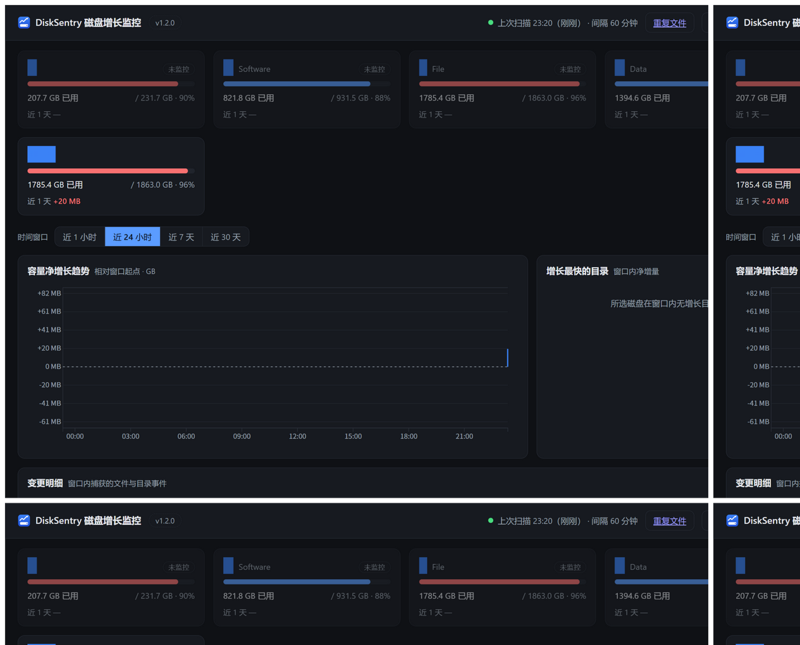
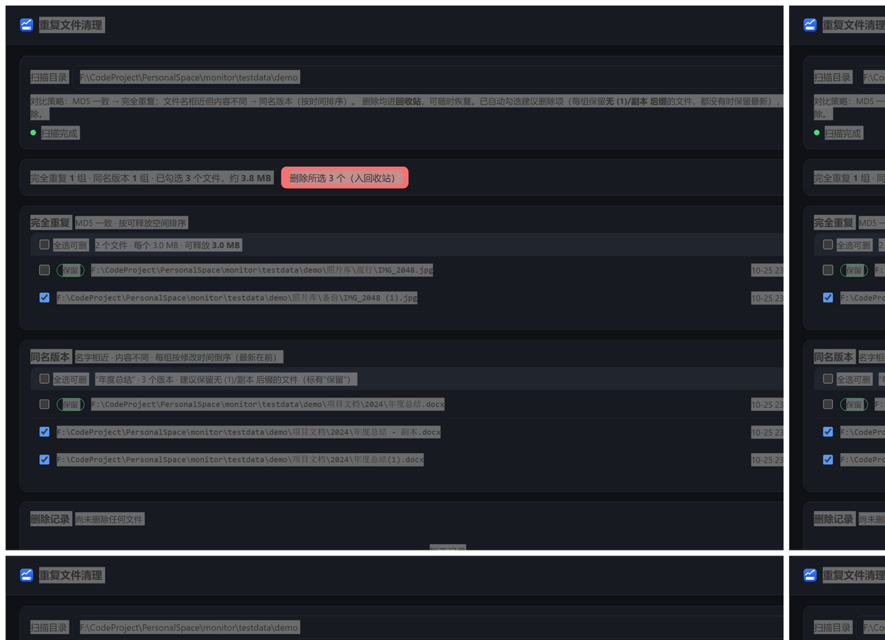

# DiskSentry 磁盘增长监控

磁盘空间"莫名上涨"时，回答**到底是哪个目录、哪个文件在涨**。

> 想参与开发/二次开发/打包细节，请读 **[DEVELOPMENT.md](DEVELOPMENT.md)**（环境搭建、调试、测试、打包、代码导览）。
> 版本历史见 **[CHANGELOG.md](CHANGELOG.md)**。





原理：定时对监控盘做全量快照扫描（只读文件元数据，不读内容），与上次状态做差分，
把每个文件的新建 / 删除 / 增长 / 缩小记录进 SQLite。任意时间窗内，都能回溯
"增长最快的目录 Top N"、"增长最快的文件" 和完整变更明细。本地 Web 仪表盘展示趋势图表。

- **零第三方依赖**：纯 Python 标准库 + 本地 d3.js，无需 pip install 任何运行库
- **重复文件清理**：仪表盘右上角入口。MD5 完全重复与"同名版本"（名字相近内容不同，
  按时间排序）分组展示，自动预选可删项（每组保留最新修改的文件），确认后批量
  删除进**回收站**（可恢复），每个文件可一键定位到资源管理器
- **低负载**：扫描期间进程自动切到 Windows 后台优先级（CPU + 磁盘 IO 最低，
  与系统索引服务同机制），系统繁忙时自动让路；可配置"仅空闲时扫描"
- **正确遍历**：跳过符号链接 / junction（防循环、防重复计数），无权限目录静默跳过，
  数据库自身目录自动排除（防止监控到自己的增长）

## 快速开始（源码运行）

```bash
cd monitor
python -m disksentry run
```

首次运行自动监控所有固定磁盘，创建数据目录 `%LOCALAPPDATA%\DiskSentry\`，
立即开始第一轮基线扫描，并自动打开浏览器 `http://127.0.0.1:8765`。
`Ctrl+C` 退出。

> 第一轮扫描只建基线、没有变更数据。基线完成后点页面上的"立即扫描"即可立刻看到差分。

## 打包成 exe

```bash
build.bat
```

脚本会自动：创建独立打包虚拟环境 `.venv-build`（不污染默认 Python 环境）→
安装 PyInstaller → 产出单文件 **`dist\DiskSentry.exe`**。

exe 的用法与源码一致，**数据默认就存放在 exe 同级的 `data\` 目录**（开箱便携；
若该目录不可写自动降级到 `%LOCALAPPDATA%\DiskSentry`）：

```bash
DiskSentry.exe                    # 常驻运行（默认监控所有固定磁盘）
DiskSentry.exe scan               # 只扫一轮
DiskSentry.exe report --hours 24  # 终端打印增长报告
DiskSentry.exe config --set interval_minutes=30
```

想改成无控制台窗口的后台 exe：把 `DiskSentry.spec` 里 `console=True` 改为
`False` 重新打包（退出需任务管理器结束进程）。

## 命令一览

| 命令 | 说明 |
| --- | --- |
| `run` | 常驻：调度扫描 + Web 仪表盘（默认） |
| `run --port N --no-browser` | 指定端口 / 不开浏览器（源码运行加 `--portable` 可将数据放项目 data\） |
| `scan [--root PATH]` | 立即扫一轮（可临时指定根） |
| `report --hours 24 --top 15` | 打印时间窗内增长报告 |
| `config [--set key=value]` | 查看 / 修改配置 |

全局参数（可放子命令前后）：`--data-dir`、`--portable`、`--verbose`。

## 配置

位置：**exe 版在 exe 同级 `data\config.json`**；源码运行默认
`%LOCALAPPDATA%\DiskSentry\config.json`（源码加 `--portable` 则用项目目录 `data\`）。
通常直接在网页右上角 ⚙ 设置对话框里改即可。

```json
{
  "disks": ["C:\\", "F:\\"],          // 监控的盘符或任意绝对路径
  "interval_minutes": 60,             // 扫描间隔
  "alert_threshold_gb_per_hour": 5.0, // 增长告警阈值（GB/小时）
  "port": 8765,
  "only_when_idle": false,            // 仅键鼠空闲时扫描
  "idle_wait_minutes": 10,
  "retention_days": 90,               // 变更明细保留天数
  "exclude": ["D:\\BT\\seeds"]        // 排除的路径前缀
}
```

## 升级与数据迁移

- **源码运行**：`git pull` 即可，数据不受影响
- **exe 升级**：退出运行中的实例，用新的 `DiskSentry.exe` 覆盖旧文件；数据库结构向后
  兼容，老库首次被新版本打开会自动补建新增的表
- **数据目录的历史变化**：v1.0.0 之前默认在 `%LOCALAPPDATA%\DiskSentry`；v1.0.0 起
  默认在 exe 同级 `data\`。想把旧历史迁过来（先退出程序）：

  ```bat
  robocopy "%LOCALAPPDATA%\DiskSentry" "exe所在目录\data" /E
  ```

- 配置中修改 `port` 需**重启程序**才生效；其余配置（监控盘/间隔/阈值/空闲扫描/
  保留天数/排除）保存即生效

## 隐私与安全

- 所有数据（配置/数据库/日志/删除记录）仅保存在本机数据目录，**不联网、不上传任何信息**
- Web 服务只绑定 `127.0.0.1`，局域网内其他设备无法访问
- 重复文件删除一律进**回收站**，可恢复；每次删除都有记录可查

## Web API（供脚本集成）

| 接口 | 说明 |
| --- | --- |
| `GET /api/state` | 磁盘列表、配置、扫描状态、最近告警 |
| `GET /api/summary?window=24` | 时间窗内各盘净变化、Top 目录/文件、变更明细 |
| `GET /api/trend?window=168` | 各盘用量净变化趋势序列（小时） |
| `GET /api/changes?window=24&order=delta` | 变更列表（order=ts\|delta，支持分页） |
| `POST /api/config` | 修改配置（JSON body） |
| `POST /api/scan` | 触发立即扫描 |
| `POST /api/dup/scan` | 启动重复文件扫描（body: {"root": 目录}，后台执行） |
| `GET /api/dup/status` / `GET /api/dup/result` | 重复扫描进度 / 结果（分组） |
| `POST /api/dup/delete` | 批量删除到回收站（body: {"paths": [...]}） |
| `POST /api/dup/reveal` | 在资源管理器中定位文件 |
| `GET /api/deletions` | 删除记录（时间/路径/大小，支持分页） |

服务只绑定 127.0.0.1，不对外网暴露。**完整参数说明与返回体结构见
[DEVELOPMENT.md §8 Web API 参考](DEVELOPMENT.md#8-web-api-参考serverpy仅绑定-127001)**。

## 项目结构

```
disksentry/           Python 包
  scanner.py          目录遍历（reparse point 跳过、路径净化、进度上报）
  store.py            SQLite：files 当前态 / changes 变更日志 / 卷快照 / 告警
  scheduler.py        定时调度、单根失败隔离、增长告警、保留策略
  server.py           本地 Web 服务（静态页 + JSON API）
  config.py           线程安全配置
  winutil.py          后台优先级 / 磁盘枚举 / 卷标 / 空闲检测（ctypes）
  report.py           终端报告
web/                  仪表盘前端（index.html + app.js + 本地 d3）
tests/                单元测试（python -m unittest discover -s tests -t .）
DiskSentry.spec       PyInstaller 配置
build.bat             一键打包
```

## 已知边界（v1.2）

- 统计的是**文件逻辑大小**（`st_size`），与压缩盘 / sparse 文件的磁盘占用有差异
- 硬链接会被计多次（如 WinSxS）；文件改名 / 移动会被记为"删除 + 新建"
  （两者都可通过 NTFS file_id 解决，留待后续版本）
- 文件名含非法代理字符时路径以 `?` 净化后入库（保证扫描不中断）
- 目录排行按变更文件的**直接父目录**聚合；大目录（如 node_modules）的深层增长
  会分散到各层子目录
- 重复文件扫描**无持久哈希缓存**，每次扫描重新计算 MD5（大目录耗时以磁盘读取为准）
- 同名版本归一化较宽松：`报告2024.docx` 与 `报告.docx` 会被视为"同名"（数字被剔除），
  分组仅供参考，删除前请确认
- 保留项（keep）只是预选建议，不是断言；请按需调整勾选后再执行删除

## 测试

```bash
python -m unittest discover -s tests -t . -v
```
